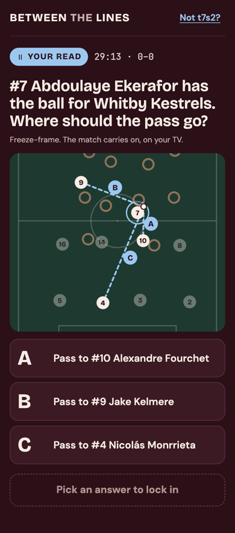
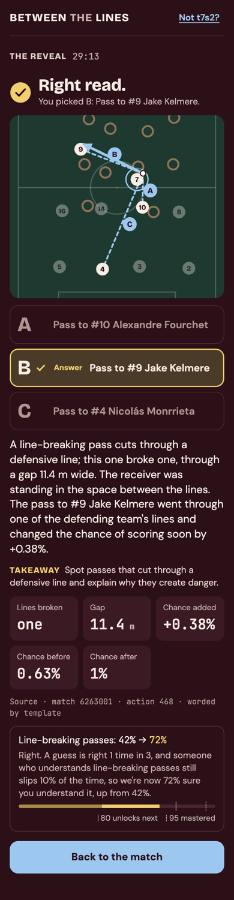
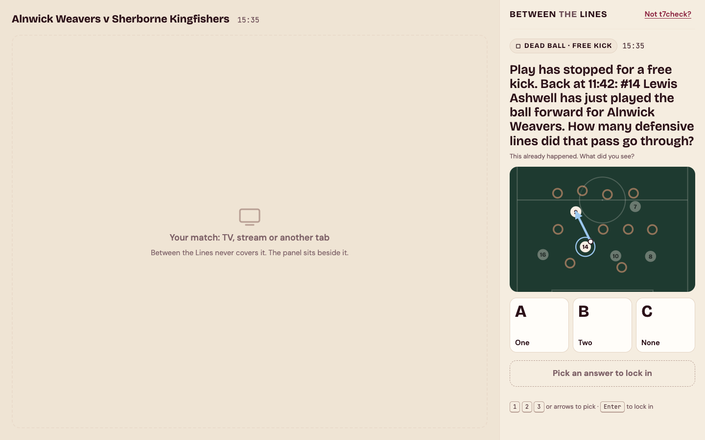

# Between the Lines

An adaptive learning tool that helps football fans understand the game better over time.

While you watch a match, it asks you about "teachable moments": in settled play it can pause and ask you to predict what should happen next, such as *"where should #8 pass?"*, and moments that happen in the rush after a turnover are saved for the next stoppage, as a question about what you just saw. Each answer gets feedback pitched at your level. A learner model tracks which football concepts you understand, and the questions adapt as you improve.

All match data is synthetic: a fictional league, fictional clubs, and fictional players.

## Status

Built for the "Inside the Game" hackathon.

| Milestone | Scope | Status |
|---|---|---|
| 1. Data engine | Event schema, match simulator, Expected Threat valuation, concept detectors, planted teachable moments, CLI | Done |
| 2a. The learning loop | Concept map, learner model (Bayesian Knowledge Tracing), phase-of-play gating, live moment selector, adaptive questions, evidence pack, templated feedback, learner storage; played in the terminal | Done |
| 2b. The AI Tutor | Question and feedback wording from a model in Azure AI Foundry, checked against the evidence by plain code | Planned |
| 2c. The web page | The same loop in a browser: a React page over a small FastAPI layer, for phone and desktop, in light and dark | Done |

Work in progress lives on milestone branches and is merged to `main` when each milestone is complete. 2c was built before 2b, while Azure wasn't set up yet.

## Quickstart

Requires [uv](https://docs.astral.sh/uv/). Full steps are in [docs/setup.md](docs/setup.md).

```sh
cd backend
uv python install 3.11
uv sync
uv run btl --help
```

## Try the learning loop

Every command runs from `backend/`. The first run learns the threat model (about 10 seconds) if it isn't there yet.

**Watch a scripted viewer improve.** `btl demo-viewer` plays three matches with a viewer who gets one question in three right in the first match, one in two in the second, and all of them in the third. Every question shows why it is being asked now, the pitch, the options, the feedback, and how the progress bars move.

```sh
uv run btl demo-viewer
```

```
───────────────────── Match 1: Ripon Wardens v Ludlow Ferrymen ─────────────────────
  Line-breaking passes  ███░░░░░░░░░░░░░░░░░   15%
  Counter-pressing      ███░░░░░░░░░░░░░░░░░   15%

Dead ball (corner), 03:38 · about play at 03:02
  (the pitch at the moment)
Play has stopped for a corner. Back at 03:02: Ripon Wardens lost the ball to Ludlow
Ferrymen. What did they do next?
  A  Stopped the attack with a foul
  B  Dropped back into their shape
  C  Hunted the ball straight back and won it
The demo viewer picks C.
Right read. After losing the ball, Ripon Wardens hunted it straight back instead of
retreating. Winning it back quickly catches the opponent before they can spread out.
The answer was Hunted the ball straight back and won it.
Takeaway: Recognize a counter-press: winning the ball straight back after losing it,
before the opponent can organize.
Right. A guess is right 1 time in 3, and someone who understands counter-pressing
still slips 10% of the time, so we're now 42% sure you understand it, up from 15%.
  Line-breaking passes  ███░░░░░░░░░░░░░░░░░   15%
  Counter-pressing      ████████░░░░░░░░░░░░   42%
```

**Play it yourself.** `btl learn` plays your next match; type A, B or C to answer. Each run is one match of three, your answers are saved as you go (in `data/learners/`, which git ignores), and Ctrl+C is safe: the next run carries on where you stopped. `--reset` starts again.

```sh
uv run btl learn --viewer yourname
```

**How it adapts.**
- **The match is the same for everyone.** Questions come only from what the concept detectors find in it, so the loop would work unchanged on a real match.
- **When it asks.** A moment in settled play can be asked live. One that happens during a transition, the seconds after the ball changes hands, waits for the next stoppage long enough for a question (a free kick, a goal kick, a corner) or for half-time or full time, and becomes a question about what you saw.
- **What and how hard.** Your mastery of each concept, estimated by Bayesian Knowledge Tracing, picks which concepts to ask about and how hard: from "how many lines did that pass break?" to "where should #8 pass?" with close alternatives. Every number you see comes from the match's evidence, never from a writer's guess, and every change in your bars comes with a sentence saying why.

[docs/concept-map.md](docs/concept-map.md) describes the curriculum, and [docs/milestone-2a/learner-model.md](docs/milestone-2a/learner-model.md) the learner model.

## Try the web page

The same loop in a browser, built to sit beside the match on a second screen: full width on a phone, and a side panel next to your stream on a desktop. It needs [Node 24](docs/setup.md#the-web-page) as well as uv.

```sh
cd frontend
npm ci
npm run build
cd ../backend
uv run btl serve      # then open http://127.0.0.1:8000
```

Type a name to start. Your answers are saved in the same records as `btl learn`, so you can start in the terminal and carry on in the browser. A reload carries on from the question you were on.

<p>
  
  
</p>


- **Questions in settled play** are asked straight away ("Your read"). Moments from a transition wait for the next stoppage or the break, which the page says when it asks.
- **Lock in, then the reveal.** The real pass is drawn on the pitch, then the verdict and the explanation appear. Every number on the page comes from the match's evidence. The browser computes nothing itself, and it is never sent the answer before you lock in.
- **Keyboard:** 1, 2 and 3 (or the arrow keys) pick an answer and Enter locks it in. Light or dark follows your system setting, and reduced motion is respected.
- **For development,** run `uv run btl serve` in `backend/` and `npm run dev` in `frontend/`; the page reloads as you edit, and `/api` is passed to the server.

## Honest limits

- **Synthetic matches.** The simulator is calibrated against 40 real matches (see the implementation notes), but it isn't real football. It plays at a slower tempo, so more of its play counts as transition (56% of playing time against 49% in real matches), and it has about 80% of the real stoppages long enough for a question. Offsides are flagged at random rather than from where players stand.
- **Expected Threat is learned from the simulator,** so it can only rediscover the simulator's own rules.
- **On a live broadcast you couldn't pause before a play.** Predict questions would have to become quick answer-in-five-seconds prompts while play continues; questions held for a stoppage would work as they are.
- **The feedback is templated** for now; Milestone 2b words it with a model, checked against the same evidence.
- **The web page steps from question to question;** it doesn't play the match. Each question says when it is asked and why, and the page is built so a played-back match can replace the step later.
- **No accounts.** The web page knows you only by the name you type, which is fine for a demo on your own machine and nothing more.
- **The learner model's numbers are set by hand,** per tier of the curriculum, not fitted to real learners' answers, and two concepts are askable so far.

## Walkthrough: the data engine

The repo includes one simulated match, [`backend/examples/match-0007`](backend/examples/match-0007), with six teachable moments planted in it. Every command below runs from `backend/`.

**1. The teachable moments.** Each one shows the play leading up to it, then the pitch where play pauses, with the team on the ball attacking left to right. The learner would be asked what happens next; the answer is the next action. Three are line-breaking passes, through a gap that narrows at each level, and three are counter-presses, where the team that lost the ball wins it straight back.

```sh
uv run btl moments examples/match-0007
```

```
──────────────── Moment 3 · line breaking pass · level 2 · 34:15 ────────────────
  (the three events leading up to it)
Play pauses after #549; the pitch at #550, attacking left to right. The answer is #550.
+-----------------------------------------------------+
|                          :                          |
|                          :                          |
|                          :                          |
|       o          o       :                          |
|                          :                          |
|                          x                          |
|                          :      x                   |
|        o         ox      :                          |
|  G                       x ··*  x             K     |
|                         ····                        |
|       o               @··:      x                   |
|                   x      x                          |
|                          : o                        |
|                          x      x                   |
|       o         o        :                          |
|                          :                          |
|                          :                          |
+-----------------------------------------------------+
@ on the ball · o teammates · G their keeper · x opponents · K opponents' keeper · * pass target
Detector: line breaking pass · difficulty 0.57 · lines broken 1 · gap (m) 12
```

**2. Watch one play out.** `btl replay` animates the 15 seconds before a moment on the same pitch, with the ball's path trailing behind it, and pauses where the learner would be asked. Press Enter to see the answer play out, ending on its full path. `--speed 2` plays twice as fast.

```sh
uv run btl replay examples/match-0007 --moment 3
```

**3. The whole match.** `btl inspect` gives each team's numbers, then the events with the football concepts the detectors found at each one. `--concept` picks out one concept, and `--start` and `--count` move through the match.

```sh
uv run btl inspect examples/match-0007
uv run btl inspect examples/match-0007 --concept counter_press
```

**4. How dangerous each action was.** Expected Threat rates every pitch zone by how likely a team with the ball there is to score soon. It is learned from simulated matches, once, in about 10 seconds. After that, `inspect` and `events` show how much threat each action added. [docs/milestone-1/expected-threat.md](docs/milestone-1/expected-threat.md) explains the model.

```sh
uv run btl fit-xt
uv run btl inspect examples/match-0007 --start 540 --count 15
```

**5. Your own matches.** The same seed always gives the same match. `--plant` asks for teachable moments by concept and level, and they happen easiest first. Matches are saved under `data/matches/`, which git ignores, and `btl matches` lists them.

```sh
uv run btl simulate --seed 42 --plant line_breaking_pass:1,2,3 --plant counter_press:2
uv run btl matches
uv run btl moments data/matches/match-0042
uv run btl tags data/matches/match-0042 --concept switch_of_play
```

The sample match is regenerated with:

```sh
uv run btl simulate --seed 7 --plant line_breaking_pass:1,2,3 --plant counter_press:1,2,3 --out examples
```

## Docs

- [docs/setup.md](docs/setup.md): setting up from a clean machine.
- [docs/event-schema.md](docs/event-schema.md): the events, possessions, and player positions a match is made of.
- [docs/concept-map.md](docs/concept-map.md): the curriculum, and how a concept becomes askable.
- [docs/milestone-1/plan.md](docs/milestone-1/plan.md): what Milestone 1 set out to build, and [implementation-notes.md](docs/milestone-1/implementation-notes.md): what changed along the way.
- [docs/milestone-2a/plan.md](docs/milestone-2a/plan.md): what Milestone 2a set out to build, [implementation-notes.md](docs/milestone-2a/implementation-notes.md): what changed along the way, and [learner-model.md](docs/milestone-2a/learner-model.md): the learner model in plain words.
- [docs/milestone-2c/plan.md](docs/milestone-2c/plan.md): what Milestone 2c set out to build, [implementation-notes.md](docs/milestone-2c/implementation-notes.md): what changed along the way, and [design/](docs/milestone-2c/design/): the design handoff the page follows.
