# Between the Lines

An adaptive learning tool that helps football fans understand the game better over time.

While you watch a match, it asks you about "teachable moments". They start with the basics, such as *"the ball's gone out: whose throw-in is it?"* or *"will the flag go up?"*. In settled play it can pause and ask you to predict what should happen next, such as *"where should #8 pass?"*, and moments that happen in the rush after a turnover are saved for the next stoppage, as a question about what you just saw. Each answer gets feedback pitched at your level. A learner model tracks which football concepts you understand, and the questions adapt as you improve.

All match data is synthetic: a fictional league, fictional clubs, and fictional players.

## Status

Built for the "Inside the Game" hackathon.

| Milestone | Scope | Status |
|---|---|---|
| 1. Data engine | Event schema, match simulator, Expected Threat valuation, concept detectors, planted teachable moments, CLI | Done |
| 2a. The learning loop | Concept map, learner model (Bayesian Knowledge Tracing), phase-of-play gating, live moment selector, adaptive questions, evidence pack, templated feedback, learner storage; played in the terminal | Done |
| 2b. The AI Tutor | Questions and feedback worded by a model in Azure AI Foundry, checked against the evidence by plain code (the Verifier), repaired once or replaced by the template; in the terminal and on the page | Done |
| 2c. The web page | The same loop in a browser: a React page over a small FastAPI layer, for phone and desktop, in light and dark | Done |
| 2d. The basics | Restarts, offside, and fouls and cards as newcomer concepts, asked at the stoppage they cause; a simulator whose blocks, offside pictures and bookings agree with the Laws | Done |
| 2e. Getting started | Pick a team to support, with club crests; a team sheet before each match that grows with you: names and positions in plain words, then the formation and kick-off shape, then players' numbers from matches you've watched | Done |
| 3. Deploy it properly | A public demo on Azure Container Apps: one `azd up` builds the container and creates every resource from Bicep; managed identity and no keys anywhere; progress kept in Blob Storage; daily limits on the model; events and queries in Log Analytics | Done |
| 4. Match day | Matches as home base, with dates and a match to rejoin; the curriculum map from any screen; halftime and full-time scouting reports with a radar; asking rules for stoppages and the whistle; Preferences | In review |
| 5. More to ask | Three more concepts (tackles and turnovers, shots and goals, transitions and counter-attacks); level icons and locked states; animated scenes of real moments, one per concept and level; the welcome as a story, and First look and Level-up flows before a match | In review |

Work in progress lives on milestone branches and is merged to `main` when each milestone is complete. 2c, 2d and then 2e were built before 2b, while Azure wasn't set up yet.

## Try it online

**<https://between-the-lines.whitesky-8ac56dd8.eastus2.azurecontainerapps.io/>**

Press Start, pick a team, and watch your first match. There is nothing to sign up for: the page gives you a random id and keeps it in this browser, so you can come back later and carry on. A model in Azure AI Foundry words the questions and feedback, checked by the Verifier; the source line under each piece of feedback says who wrote it. If the page takes half a minute to appear, it was asleep: it scales to zero when nobody is using it.

How it is deployed, and how to deploy your own: [docs/deployment.md](docs/deployment.md).

## Quickstart

Requires [uv](https://docs.astral.sh/uv/). Full steps are in [docs/setup.md](docs/setup.md).

```sh
cd backend
uv python install 3.11
uv sync
uv run btl --help
```

## Try the learning loop

Every command runs from `backend/`. The first run learns the threat model (about 10 seconds) if it isn't there yet.

**Watch a scripted viewer improve.** `btl demo-viewer` plays three matches with a viewer who gets one question in three right in the first match, one in two in the second, and all of them in the third. Every question shows why it is being asked now, the pitch, the options, the feedback, and how the progress bars move.

```sh
uv run btl demo-viewer
```

```
───────────────────── Match 1: Ripon Wardens v Ludlow Ferrymen ─────────────────────
  Restarts              ███████░░░░░░░░░░░░░   35%
  Offside               ███████░░░░░░░░░░░░░   35%
  Fouls and cards       ███████░░░░░░░░░░░░░   35%
  Line-breaking passes  ███░░░░░░░░░░░░░░░░░   15%
  Counter-pressing      ███░░░░░░░░░░░░░░░░░   15%

00:08 · live, as play stops
  (the pitch at the moment, with the ball's path out of play)
The ball has gone over the touchline, last touched by Ripon Wardens. What happens now?
  A  Corner to Ludlow Ferrymen
  B  Throw-in to Ripon Wardens
  C  Throw-in to Ludlow Ferrymen
The demo viewer picks C.
Right read. When the ball goes out, the team that didn't touch it last gets it back.
Over a touchline that's a throw-in; over a goal line it's a corner or a goal kick. The
answer was Throw-in to Ludlow Ferrymen.
Takeaway: Say which restart comes next, and for which team, when the ball goes out of
play.
Right. A guess is right 1 time in 3, and someone who understands restarts still slips
10% of the time, so we're now 67% sure you understand it, up from 35%.
  Restarts              █████████████░░░░░░░   67%
```

**Play it yourself.** `btl learn` plays your next match; type A, B or C to answer. Each run is one match of three, your answers are saved as you go (in `data/learners/`, which git ignores), and Ctrl+C is safe: the next run carries on where you stopped. `--reset` starts again. `--club HEX` (a club's name or three-letter code) makes your three matches that club's fixtures; it can change only until your first answer.

```sh
uv run btl learn --viewer yourname
```

**How it adapts.**
- **The match is the same for everyone.** Questions come only from what the concept detectors find in it, so the loop would work unchanged on a real match.
- **When it asks.** A moment in settled play can be asked live. One that happens during a transition, the seconds after the ball changes hands, waits for the next stoppage long enough for a question (a free kick, a goal kick, a corner) or for half-time or full time, and becomes a question about what you saw. A restart or a foul is asked in the stoppage it causes, before the restart is taken: what happens now?
- **The basics first, but not only.** Restarts, offside, and fouls and cards are newcomer concepts. A match asks about them at most three times, so the other concepts still come up from the first match.
- **What and how hard.** Your mastery of each concept, estimated by Bayesian Knowledge Tracing, picks which concepts to ask about and how hard: from "how many lines did that pass break?" to "where should #8 pass?" with close alternatives. Every number you see comes from the match's evidence, never from a writer's guess, and every change in your bars comes with a sentence saying why.

[docs/concept-map.md](docs/concept-map.md) describes the curriculum, and [docs/milestone-2a/learner-model.md](docs/milestone-2a/learner-model.md) the learner model.

## Try the web page

The same loop in a browser, built to sit beside the match on a second screen: full width on a phone, and a side panel next to your stream on a desktop. It needs [Node 24](docs/setup.md#the-web-page) as well as uv.

```sh
cd frontend
npm ci
npm run build
cd ../backend
uv run btl serve      # then open http://127.0.0.1:8000
```

The first screen says what the questions cover. Press Continue, then pick a team to support, or let the page pick one for you. Your three matches are that club's fixtures, and **Matches** is home base: the next match with its date, a match you left part-way through to rejoin, your level on each concept in words, and the reports of matches you've finished. Before each match, "Who's playing" shows both elevens, your team first. There is no sign-in: the page gives you a random id and keeps it in this browser, so a reload, or a visit another day, brings you back to Matches. "Start over" forgets it, after asking. Your answers are saved in the same kind of record `btl learn` writes.

<p>
  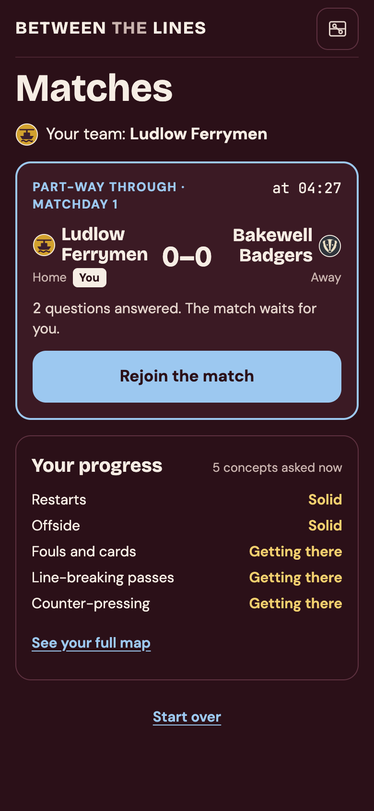
  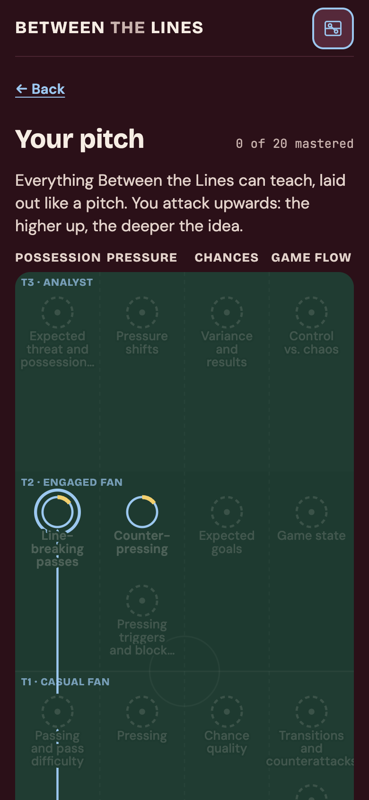
  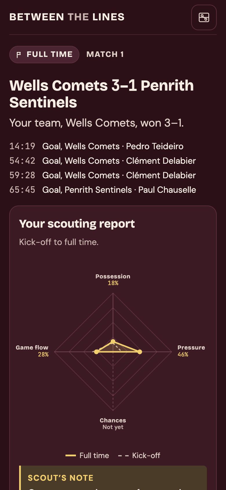
</p>
<p>
  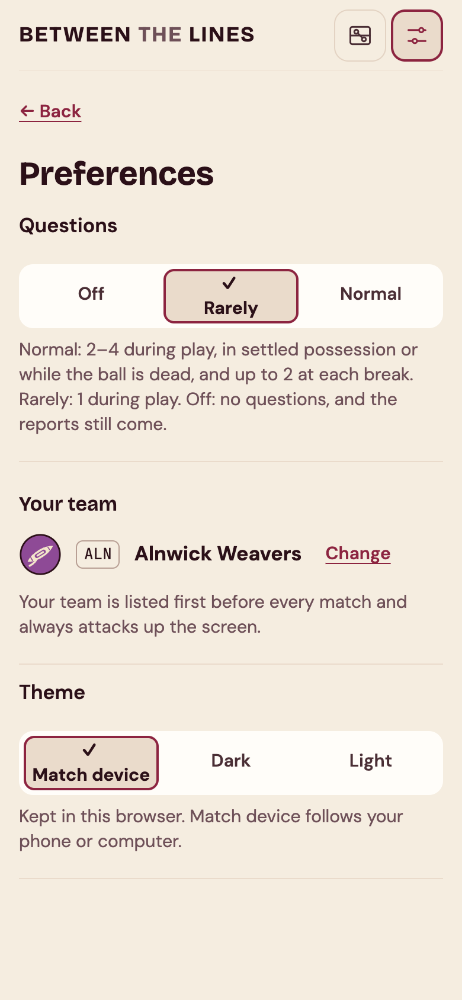
  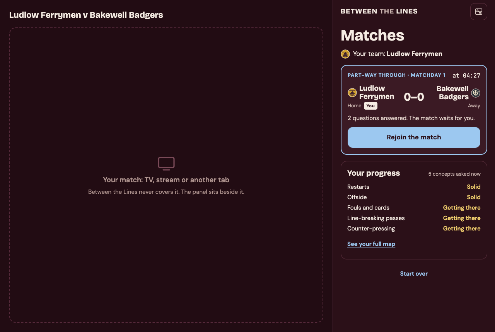
</p>

<p>
  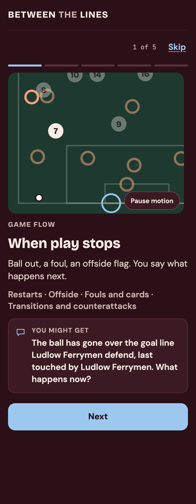
  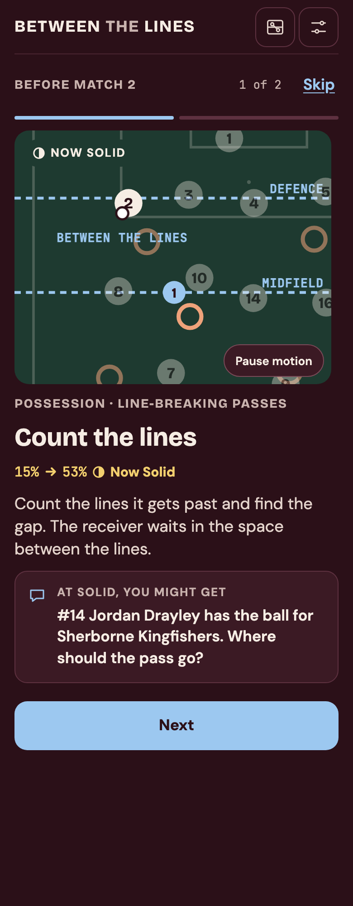
  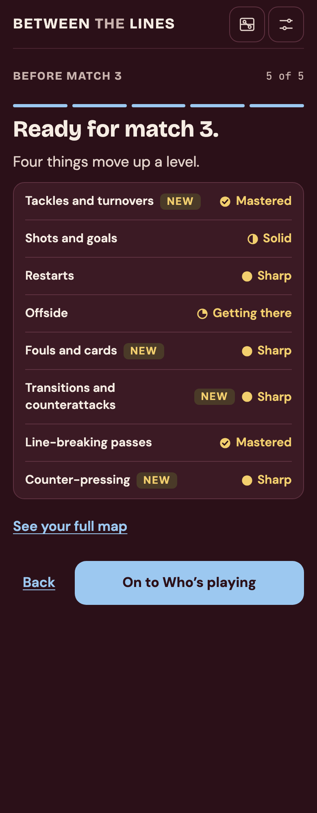
</p>
<p>
  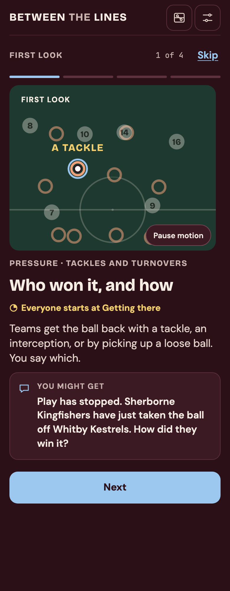
  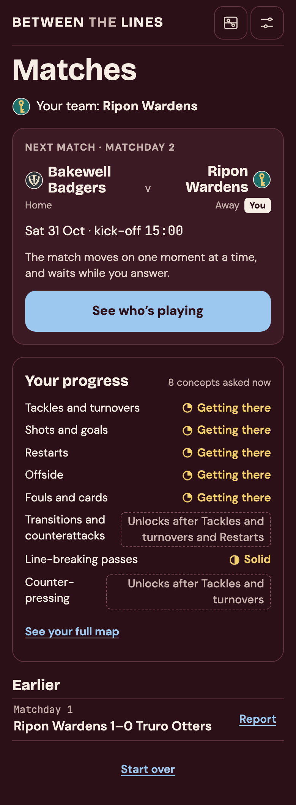
</p>

<p>
  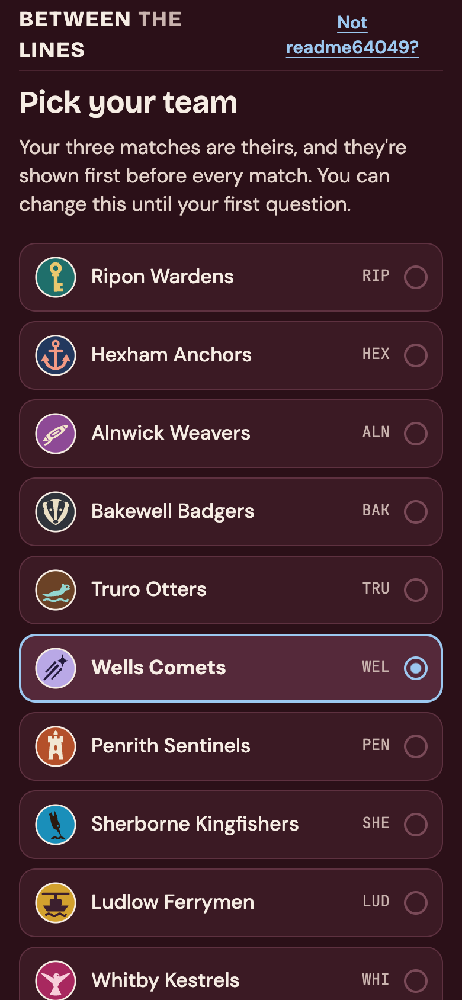
  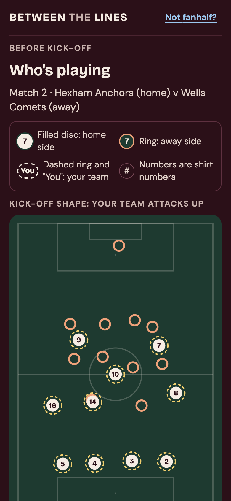
  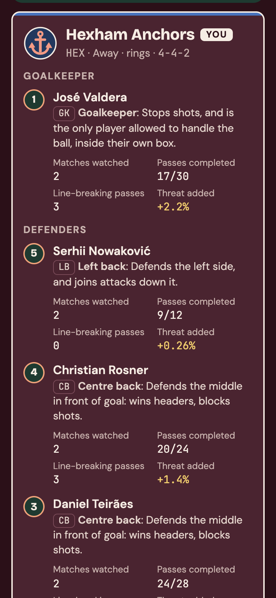
</p>

<p>
  
  
</p>


- **The welcome is a story.** One step per strand, each with an animated scene of a real moment from the data and a question you might get, then where everyone starts. Before a match, a **First look** introduces any concept new to you, and a **Level-up** shows each concept that moved up (Solid, Sharp, Mastered) with its scene at the new level, your levels, and what the team sheet now shows. Every scene has a Pause motion button, and with reduced motion it is a still frame.
- **Eight concepts are asked about:** restarts, offside, fouls and cards, tackles and turnovers, shots and goals, line-breaking passes, counter-pressing, and transitions and counter-attacks. A concept that waits on another says so ("Unlocks after Tackles and turnovers") wherever levels are listed, and every level word has an icon beside it.
- **The team sheet grows with you.** A beginner sees each player's shirt number, name and position in plain words ("Left back: defends the left side, and joins attacks down it"). Get to Solid in any concept and it adds the formation and where everyone stood at kick-off; at Sharp it adds each player's passes, line-breaking passes and threat added, counted only from matches you have finished, so it never hints at what you'll be asked. Your team is marked on the pitch with a dashed ring and on every screen with "You", never by colour alone.
- **Questions in settled play** are asked straight away ("Your read"), and so are restarts and fouls, in the stoppage they cause. Moments from a transition wait for the next stoppage or the break, which the page says when it asks. A throw-in question marks where the ball went out, and an offside reveal draws the offside line.
- **Lock in, then the reveal.** The real pass is drawn on the pitch, then the verdict and the explanation appear. Every number on the page comes from the match's evidence. The browser computes nothing itself, and it is never sent the answer before you lock in.
- **The map from anywhere.** The map button in every header opens "Your pitch": all 20 concepts by strand and tier, the eight asked now with your level and its icon (or what they unlock after), the rest coming later. Choose one to see what it builds on. Back (or Esc) returns you to the same screen and scroll position, with a half-answered question just as you left it.
- **Scouting reports** come at halftime and full time: the score and goals, a radar of the four strands from kick-off to now (Chances says "Not yet" rather than zero), a scout's note in words, and the questions you answered. Finished matches keep their report on Matches.
- **Asking rules.** One question per stoppage: a restart's own question wins and a saved one waits. Nothing is asked in the last 30 seconds of a half; a settled moment there waits for the break. After you answer, the next step says what happened while you were answering.
- **Preferences** (the ⚙ in the header): questions normal, rarely or off (a change made during a match starts with the next one), your team while it can still change, and light, dark or your device's theme.
- **Keyboard:** 1, 2 and 3 (or the arrow keys) pick an answer and Enter locks it in. Reduced motion is respected.
- **"Done for this match"** goes back to Matches at any step; Rejoin carries on at the same question.
- **For development,** run `uv run btl serve` in `backend/` and `npm run dev` in `frontend/`; the page reloads as you edit, and `/api` is passed to the server.

## Try the AI Tutor

By default every question and explanation is worded by templates written in code. With `--tutor foundry`, a model in Azure AI Foundry (`gpt-5.4-nano`) words them instead, and plain code checks every word before you see it. Setting it up needs an Azure subscription and the Azure CLI: [docs/setup.md](docs/setup.md#optional-the-ai-tutor-azure) has the steps, and the app signs in with your `az login`, never with a key.

```sh
cd backend
uv run btl tutor-ping                                # one small call: is the model there?
uv run btl learn --viewer yourname --tutor foundry   # the terminal
uv run btl serve --tutor foundry                     # the web page
uv run btl tutor-eval --seeds 3 --per-kind 2         # measure it (about 230 calls)
```

- **The model writes words around slots, and code fills in the facts.** It writes `{answer.threat_added}`, never "+0.22%", so every number and name you see comes from the match's evidence. A value it writes out in full is turned back into its slot before checking.
- **The Verifier checks every reply** with eleven plain-code checks:
  - no number or name outside the evidence;
  - no hint at the answer before you've answered;
  - no verdict, which the grade gives;
  - the answer and a fact that settles it are cited;
  - comparisons match the numbers;
  - nothing said twice;
  - lengths.

  [docs/milestone-2b/verifier.md](docs/milestone-2b/verifier.md) explains each one with an example.
- **One repair, then the template.** A reply that fails is sent back once with the reasons. If it fails again, or the call fails or is slow, the template's words are used. Under each explanation you can see who wrote it: "worded by gpt-5.4-nano", "(repaired)", or "template (fallback: …)".
- **It knows your recent answers, but not who you are.** After a wrong answer the explanation can open with a word about how you've been doing on that concept ("You've been reading these well lately, but…"). Nothing about you goes to the model: no name, no id, no team.
- **The web page words each question once.** A reload shows the same words, and the model is never asked twice.
- **Wording never changes what you learn.** The same answers give the same record whichever Tutor runs, which the tests check with and without a team.
- **How well it does** ([docs/milestone-2b/tutor-evaluation.md](docs/milestone-2b/tutor-evaluation.md)):
  - 80% of the model's first replies pass every check, and 92% of shown text is the model's after the repair (100% of questions, 88% of feedback);
  - a call takes about 1.8 s (2.6 s at the 95th percentile);
  - a wording uses about 1,200 tokens in and 120 out.

  Every call is logged to `data/tutor-log.jsonl`.

## Watching the demo

In Azure, the app writes one JSON line for each step of the loop (`backend/src/btl/api/events.py` lists them all): `question_asked`, `answer_graded`, `mastery_updated`, `full_time`, `model_call`, `wording_fallback` and `limit_reached`. Container Apps sends them to the Log Analytics workspace, where they arrive in the `ContainerAppConsoleLogs` table a few minutes later. The viewer id in them is the random id the browser made.

Run these in the portal (the workspace `log-…` → **Logs**), or from the command line:
```sh
az monitor log-analytics query --subscription <subscription-id> \
  --workspace "$(azd env get-value AZURE_LOG_ANALYTICS_CUSTOMER_ID)" --analytics-query '<query>'
```

**The funnel, by day:** who came, and how far they got. A reload asks a question again, so questions are counted once each.
```kql
ContainerAppConsoleLogs
| where Log startswith '{"event"'
| extend e = parse_json(Log)
| extend Event = tostring(e.event), Viewer = tostring(e.viewer_id)
| summarize
    Visitors = dcountif(Viewer, Event == "question_asked"),
    Questions = dcountif(strcat(Viewer, "/", tostring(e.pack_id)), Event == "question_asked"),
    Answers = countif(Event == "answer_graded"),
    RightAnswers = countif(Event == "answer_graded" and tobool(e.correct)),
    MatchesFinished = countif(Event == "full_time")
    by Day = startofday(TimeGenerated)
| order by Day desc
```

**Who worded the feedback, by concept:** the model, the template after a failed check or a failed call (the next query says which), or the template past a daily limit.
```kql
ContainerAppConsoleLogs
| where Log startswith '{"event"'
| extend e = parse_json(Log)
| where tostring(e.event) == "answer_graded"
| extend Concept = tostring(e.concept), Source = tostring(e.source)
| extend WordedBy = case(
    Source startswith "template (fallback", "Template: fallback",
    Source startswith "template (daily limit", "Template: daily limit",
    Source == "template", "Template: model off",
    "Model")
| summarize Feedback = count() by Concept, WordedBy
| as Counts
| join kind=inner (Counts | summarize Total = sum(Feedback) by Concept) on Concept
| project Concept, WordedBy, Feedback, Share = round(100.0 * Feedback / Total, 1)
| order by Concept asc, Feedback desc
```

**The model, by day:** calls, how often the first try passes, failed calls, speed, tokens and an estimated cost (set the prices to the deployment's current ones, per million tokens).
```kql
let PriceIn = 0.20;
let PriceOut = 1.25;
ContainerAppConsoleLogs
| where Log startswith '{"event"'
| extend e = parse_json(Log)
| extend Event = tostring(e.event)
| where Event in ("model_call", "wording_fallback", "limit_reached")
| extend Call = Event == "model_call", Failed = isnotempty(tostring(e.error))
// Seconds only for calls that got a reply; percentiles skip the empty ones.
| extend Seconds = iff(Call and not(Failed), todouble(e.seconds), real(null))
| summarize
    Calls = countif(Call),
    // Of the first tries that got a reply: comparable with docs/milestone-2b/tutor-evaluation.md.
    FirstTries = countif(Call and not(Failed) and toint(e.attempt) == 1),
    FirstTriesPassed = countif(Call and toint(e.attempt) == 1 and tobool(e.passed)),
    NoReply = countif(Call and Failed),
    P50Seconds = round(percentile(Seconds, 50), 2),
    P95Seconds = round(percentile(Seconds, 95), 2),
    TokensIn = sumif(tolong(e.input_tokens), Call),
    TokensOut = sumif(tolong(e.output_tokens), Call),
    Fallbacks = countif(Event == "wording_fallback"),
    LimitsReached = countif(Event == "limit_reached")
    by Day = startofday(TimeGenerated)
| extend FirstTryPassRate = round(100.0 * FirstTriesPassed / FirstTries, 1)
| extend EstimatedCost = round((TokensIn * PriceIn + TokensOut * PriceOut) / 1e6, 3)
| project Day, Calls, FirstTryPassRate, NoReply, P50Seconds, P95Seconds, TokensIn, TokensOut,
    EstimatedCost, Fallbacks, LimitsReached
| order by Day desc
```

**Why the template was used:** the Verifier's failed checks, or "no reply" when a call failed (a 429 from the deployment's token cap counts here).
```kql
ContainerAppConsoleLogs
| where Log startswith '{"event"'
| extend e = parse_json(Log)
| where tostring(e.event) == "wording_fallback"
| mv-expand Reason = e.reasons to typeof(string)
| summarize Times = count() by Reason, Kind = tostring(e.kind)
| order by Times desc
```

## Honest limits

- **Synthetic matches.** The simulator is calibrated against 40 real matches (see the implementation notes), but it isn't real football. It plays at a slower tempo, so more of its play counts as transition (54% of playing time against 49% in real matches), and it has about 80% of the real stoppages long enough for a question. Offside flags and bookings are drawn by chance, as they always were, and the players' positions are then drawn to agree with them: a flagged receiver stands past the offside line, and most bookings stop a promising attack.
- **Event data doesn't record a block.** About one throw-in in five and nearly half of corners follow the restarting team's own action in real event data, and the simulator does the same. The app works out the last touch from the Laws: the restart always goes against it.
- **Expected Threat is learned from the simulator,** so it can only rediscover the simulator's own rules.
- **On a live broadcast you couldn't pause before a play.** Predict questions would have to become quick answer-in-five-seconds prompts while play continues; questions held for a stoppage would work as they are.
- **The Verifier checks the model's facts, not its football.** It can tell that every number and name came from the evidence, and that nothing gives the answer away. It can't tell whether an explanation of the Laws is true, or pitched at the right level. A hand review of twenty samples found them accurate enough for a prototype, but some wording is clumsy ("For how many defensive lines did that pass go through"), and so are some of the remarks about your recent answers.
- **About one explanation in eight falls back to the template,** most often for fouls, whose facts are whole sentences the model tends to fold into its own. The numbers vary by a few points from run to run.
- **The AI Tutor needs Azure.** Without it, the templates word everything, as they always did.
- **The web page steps from question to question;** it doesn't play the match. Each question says when it is asked and why, and the page is built so a played-back match can replace the step later. So the design's companion features wait for a live clock: following your TV's clock with a ±10 s sync, saving a question for the break, and a "live now" match on Matches.
- **The explanation level can't be chosen yet,** and there is no Simpler / Deeper on the reveal: the explanation follows your level on each concept.
- **No accounts.** The web page knows you only by a random id kept in your browser. Nobody can guess it, but your progress lives in that one browser: another device, or cleared site data, starts afresh.
- **The online demo's model has a small ceiling.** Its deployment allows 30,000 tokens and 30 requests a minute, about two or three people playing at once; past that, and past each viewer's 60 wordings a day or everyone's 1,000, the template words it instead. The daily counts are kept in memory, so a restart starts them again.
- **The online demo sleeps.** It scales to zero when idle, so the first visit after a quiet spell waits about 30 seconds. While judges are likely to visit, one replica is kept warm.
- **Every club plays 4-4-2,** so the team sheet's formation never changes. Giving clubs their own shape would change every match, and the simulator's realism checks with it.
- **Line-breaking passes are counted generously on the team sheet.** The simulator's flat midfield lines let short passes between level players count, so a central midfielder makes about 17–19 a match. Questions only use the clearer ones.
- **The learner model's numbers are set by hand,** per tier of the curriculum, not fitted to real learners' answers, and eight concepts are askable so far.

## Walkthrough: the data engine

The repo includes one simulated match, [`backend/examples/match-0007`](backend/examples/match-0007), with six teachable moments planted in it. Every command below runs from `backend/`.

**1. The teachable moments.** Each one shows the play leading up to it, then the pitch where play pauses, with the team on the ball attacking left to right. The learner would be asked what happens next; the answer is the next action. Three are line-breaking passes, through a gap that narrows at each level, and three are counter-presses, where the team that lost the ball wins it straight back.

```sh
uv run btl moments examples/match-0007
```

```
──────────────── Moment 3 · line breaking pass · level 2 · 34:27 ────────────────
  (the three events leading up to it)
Play pauses after #525; the pitch at #526, attacking left to right. The answer is #526.
+-----------------------------------------------------+
|                          :                          |
|                          :                          |
|                          :                          |
|                          :                          |
|     o         o          :                          |
|                          :                          |
|                         o:  x                       |
|     o         o      x   :                          |
|               x          :                          |
|  G                       :  x                K      |
|                      x ··*                          |
|     o               ···· :  x                       |
|               x  @···    :                          |
|                      x   :                          |
|     o         o          :  x                       |
|                      x   :                          |
|                          :                          |
+-----------------------------------------------------+
@ on the ball · o teammates · G their keeper · x opponents · K opponents' keeper · * pass target
Detector: line breaking pass · difficulty 0.57 · lines broken 1 · gap (m) 12
```

**2. Watch one play out.** `btl replay` animates the 15 seconds before a moment on the same pitch, with the ball's path trailing behind it, and pauses where the learner would be asked. Press Enter to see the answer play out, ending on its full path. `--speed 2` plays twice as fast.

```sh
uv run btl replay examples/match-0007 --moment 3
```

**3. The whole match.** `btl inspect` gives each team's numbers, then the events with the football concepts the detectors found at each one. `--concept` picks out one concept, and `--start` and `--count` move through the match.

```sh
uv run btl inspect examples/match-0007
uv run btl inspect examples/match-0007 --concept counter_press
```

**4. How dangerous each action was.** Expected Threat rates every pitch zone by how likely a team with the ball there is to score soon. It is learned from simulated matches, once, in about 10 seconds. After that, `inspect` and `events` show how much threat each action added. [docs/milestone-1/expected-threat.md](docs/milestone-1/expected-threat.md) explains the model.

```sh
uv run btl fit-xt
uv run btl inspect examples/match-0007 --start 515 --count 15
```

**5. Your own matches.** The same seed always gives the same match. `--plant` asks for teachable moments by concept and level, and they happen easiest first. Matches are saved under `data/matches/`, which git ignores, and `btl matches` lists them.

```sh
uv run btl simulate --seed 42 --plant line_breaking_pass:1,2,3 --plant counter_press:2
uv run btl matches
uv run btl moments data/matches/match-0042
uv run btl tags data/matches/match-0042 --concept switch_of_play
```

The sample match is regenerated with:

```sh
uv run btl simulate --seed 7 --plant line_breaking_pass:1,2,3 --plant counter_press:1,2,3 --out examples
```

## Docs

- [docs/setup.md](docs/setup.md): setting up from a clean machine.
- [docs/deployment.md](docs/deployment.md): the online demo in Azure: what is deployed, how it fits together, changing it, costs, and taking it down.
- [docs/event-schema.md](docs/event-schema.md): the events, possessions, and player positions a match is made of.
- [docs/concept-map.md](docs/concept-map.md): the curriculum, and how a concept becomes askable.
- [docs/milestone-1/plan.md](docs/milestone-1/plan.md): what Milestone 1 set out to build, and [implementation-notes.md](docs/milestone-1/implementation-notes.md): what changed along the way.
- [docs/milestone-2a/plan.md](docs/milestone-2a/plan.md): what Milestone 2a set out to build, [implementation-notes.md](docs/milestone-2a/implementation-notes.md): what changed along the way, and [learner-model.md](docs/milestone-2a/learner-model.md): the learner model in plain words.
- [docs/milestone-2c/plan.md](docs/milestone-2c/plan.md): what Milestone 2c set out to build, [implementation-notes.md](docs/milestone-2c/implementation-notes.md): what changed along the way, and [design/](docs/milestone-2c/design/): the design handoff the page follows.
- [docs/milestone-2d/plan.md](docs/milestone-2d/plan.md): what Milestone 2d set out to build, and [implementation-notes.md](docs/milestone-2d/implementation-notes.md): what changed along the way.
- [docs/milestone-2e/plan.md](docs/milestone-2e/plan.md): what Milestone 2e set out to build, [implementation-notes.md](docs/milestone-2e/implementation-notes.md): what changed along the way, and [design/](docs/milestone-2e/design/) and [crests/](docs/milestone-2e/crests/): the team sheet, picker and crest designs.
- [docs/milestone-2b/plan.md](docs/milestone-2b/plan.md): what Milestone 2b set out to build, [implementation-notes.md](docs/milestone-2b/implementation-notes.md): what changed along the way, [verifier.md](docs/milestone-2b/verifier.md): each of the Verifier's checks, and [tutor-evaluation.md](docs/milestone-2b/tutor-evaluation.md) with [tutor-review.md](docs/milestone-2b/tutor-review.md): how well the model does.
- [docs/milestone-3/plan.md](docs/milestone-3/plan.md): what Milestone 3 set out to build, and [implementation-notes.md](docs/milestone-3/implementation-notes.md): what changed along the way.
- [docs/milestone-4/plan.md](docs/milestone-4/plan.md): what Milestone 4 set out to build, [implementation-notes.md](docs/milestone-4/implementation-notes.md): what changed along the way, and [design/](docs/milestone-4/design/): the user flow, Matches, reports and Preferences designs.
