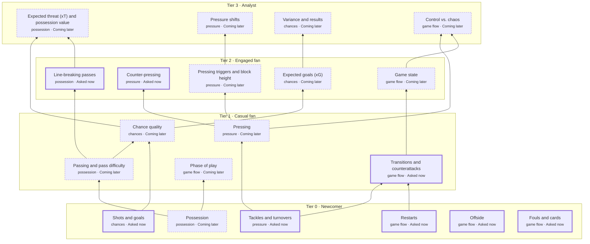

# Concept map

The concept map is the curriculum: every football idea the app can teach, how the ideas build on each other, and the words used to explain them. It lives in [`backend/src/btl/learn/concept_map.yaml`](../backend/src/btl/learn/concept_map.yaml). Only `btl/learn/concept_map.py` reads it, and that module refuses a file that breaks any rule below, listing every problem at once.

## What's in it

- **Tiers** run from 0 (Newcomer: follow what is happening) to 3 (Analyst: judge under uncertainty).
- **Strands** group concepts by theme: possession, pressure, chances, game flow.
- **Concepts.** Each concept has:
  - a tier and a strand;
  - prerequisites;
  - a learning objective;
  - the detector that finds it in a match, if one exists;
  - the question types it suits;
  - explanations at three levels (beginner, intermediate, analyst);
  - common misconceptions;
  - the evidence fields its explanations need.
- **Learner model settings**, under `learner_models`, by model name. Each model has its own thresholds and its own parameters for each tier, and a concept can override them. Bayesian Knowledge Tracing (`bkt`) is the only model so far.

## The whole map

All 20 concepts, tier 0 at the bottom, each arrow pointing from a prerequisite to what it unlocks. The eight asked about now have a heavy outline; the rest are coming later, drawn dashed. On the page the same map is "Your pitch" (CM-A), opened from the map button in any header.

## Active concepts and the frontier

A concept is **active** when the app can ask about it: a detector finds it in a match, and questions can be built for it. Eight concepts are active: `line_breaking_pass` and `counter_press` (Milestone 2a), the tier-0 basics `restarts`, `offside` and `fouls_and_cards` (Milestone 2d), and `tackles`, `shots_and_goals` and `transitions` (Milestone 5). The other concepts are the curriculum still to build.

Tier-0 concepts come round every few minutes in a match, so the selector asks about each at most twice a match, and about all of them at most five times. That leaves room for the others from a viewer's first match.

The **frontier** is what's worth asking about now: active concepts that aren't mastered yet and whose prerequisites are unlocked. Two thresholds from the knowledge model decide this: unlock (0.8 for BKT) and mastery (0.95).

**A prerequisite that isn't active counts as met, but its own prerequisites still apply.** `counter_press` needs `pressing`, which isn't active, which needs `tackles`, which is. So `counter_press` waits until `tackles` is unlocked (0.8), and so does `transitions`, which needs `tackles` and `restarts` directly. On the page those two show as locked ("Unlocks after Tackles and turnovers") until then, and before Milestone 5 made `tackles` active they were on a new viewer's frontier straight away. The frontier gets stricter by itself as concepts are built, with no change to the map.

## Placeholders

Text in `{braces}` is filled in by code from the evidence pack, so the Tutor never writes a number itself. Every placeholder must be one of the concept's `evidence_fields`. The exceptions are `{home_team}` and `{away_team}`, which every match provides. Units stay in the text ("a gap {gap_m} m wide"), so a placeholder becomes a bare number.

## Rules the loader checks

- `version` is the one the code reads.
- Every model has thresholds with 0 < unlock < mastery < 1, and parameters for every tier, with the same parameter names in each tier. A concept's overrides name only parameters the model has.
- Concept ids are unique.
- Every prerequisite is a concept in the map, and prerequisites never form a cycle.
- Tiers, strands, question types and data requirements (`events`, `snapshot`, `window`) are the declared ones.
- Every placeholder is in its concept's evidence fields.
- `detector` is a `ConceptId` (`line_breaking_pass`, `counter_press`, `counter_attack`, `switch_of_play`, `restart`, `offside`, `foul`, `ball_win`, `shot`) or null, and no detector belongs to two concepts.
- No betting words anywhere (a hard rule for the project).

## Adding a concept to what the app can ask

1. Write or check its entry in the map, with `detector` set to its `ConceptId`.
2. Give it a detector in `btl/concepts/`, with a difficulty from 0 to 1, and register it in `registry.py`.
3. Give it an entry in each table in `btl/learn/`:
   - `QUESTIONS` in `questions.py`: its form for a moment, level and delivery, and how its options are built;
   - `FACTS` in `evidence.py`: what is known before answering, and what answers;
   - if it needs one, a quality rule in `WORTH_TEACHING` (`candidates.py`), when its moments may be asked in `ASKED_WHEN` (`candidates.py`; by default, live in settled play and reviewed later otherwise), and the play a question shows in `SHOWN` (`evidence.py`).
4. Give its questions wording in `btl/tutor/templates.py`.
5. Make sure its facts include every field in `evidence_fields`; a test checks this.

Once it's active, every concept that lists it as a prerequisite starts waiting for it.
